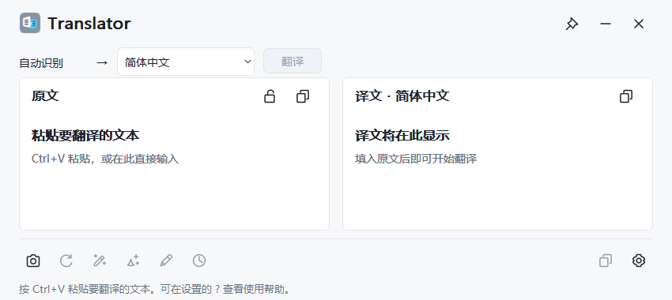
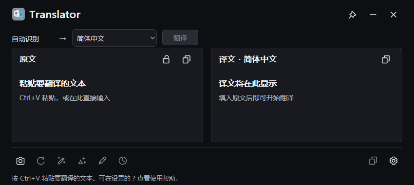

# Snipaste AI Translator

[English](README.md) · **v0.9.0-preview** · Apache-2.0

一款极轻量、原生 Windows、支持可扩展 OCR 来源及自定义 AI API 的翻译与文本处理工具。
粘贴翻译是独立于 OCR 的核心能力。Snipaste 是当前唯一已实现的 OCR 适配器；
本项目为独立工具，并非 Snipaste 官方插件。其他 OCR 来源属于后续计划。

**当前仅为本地 PREVIEW 候选，Stable 正式发布 NO-GO。** 严格 GUI 资源稳定性门仍有未解决失败。
最终二进制的真实 OCR／云端 Provider、真人 IME、物理混合 DPI、多屏、Win11 和干净机验收均为
UNVERIFIED。完整结论见 [发布准备报告](docs/GITHUB_RELEASE_READINESS.md)。

## 实际界面




来自当前生产 EXE 实际窗口的 PrintWindow 截图，原文／译文为空，未发送 API 请求。
截图用于展示界面，不代表真实翻译或 OCR 已通过验收。

## 主要特点

- C++20 + Win32，原生 RichEdit、WinHTTP、DPAPI、Direct2D 图标及静态 CRT；
  无 Electron、Qt、WebView2、Python 产品运行时、模型包或数据库。
- SSE 流式翻译、目标语言选择、原文解锁编辑／恢复及明确提交。
- 自然、简洁、口语、正式、文艺五种改写；自然化／去 AI 味，不承诺绕过 AI 检测。
- 自定义指令支持原文+译文、仅译文、仅原文三范围；上限 2000 UTF-16 code units；
  可关闭本次会话的提示词记忆。
- 仅完整成功结果进入内存版本历史，默认 10 条，可设 1–50 条，支持回退。
- 多模型配置及翻译／改写角色绑定、深浅／系统主题、工具顺序与显隐、窄窗更多菜单。
- 显式 Snipaste 路径、等待超时／取消及可选候选确认。剪贴板变化无法证明 OCR 来源。

最后窗口关闭后本工具退出。用户自己的 OCR 工具或本地模型服务拥有独立生命周期，可能继续运行。

## 下载、安装与卸载

源码仓库：[GitHub](https://github.com/rowanjove/Snipaste-AI-Translator)。用户已批准仅公开源码，当前没有二进制下载。
待发布门闭合并另经所有者批准后，才能建立 GitHub Pre-release。
本地候选位置：`release/Translator-v0.9.0-preview-Win10-x64.zip`。
先用同目录 `SHA256SUMS.txt` 校验，解压到可写目录，运行 `Translator.exe`。
无需安装器，通常无需管理员权限。**EXE 未签名**，未取得或声称 Windows 代码签名认证。

当前本机自动化环境为 Windows 10 x64 build 19045、VS2022/MSVC 与 Windows SDK。
PREVIEW 面向 Win10 x64；Windows 11 x64 尚未实机验收。未提供 x86、ARM64、Linux 或 macOS 版本。
AI 操作需要用户自己的兼容服务、账号和网络；只有 Snipaste OCR 功能需要专业版桌面安装与授权。

卸载时关闭程序并删除解压目录。配置和 DPAPI 凭据保留在
`%LOCALAPPDATA%/SnipasteAITranslator`；仅当明确希望删除自己的配置时才手动删除该目录。
本轮整理不会删除它、注销 OCR 工具或撤销 API Key。

## 粘贴翻译和截图翻译

1. 打开窗口，Ctrl+V 载入文字，选择目标语言。
2. 在设置 → 模型与 API 中填写模型方案。启用自动翻译时，采用新输入可立即发送；
   关闭时点击“翻译”。解锁原文后可以编辑，Ctrl+Enter 明确提交。
3. 截图前先启动已授权的 Snipaste 专业版桌面程序，在“常规”设置指定准确 EXE 路径。
   默认通用路径 `C:\Tools\Snipaste\Snipaste.exe`；不会搜索 PATH 或回退 WindowsApps。
4. 建议开启“候选确认”，核对文字后采用；敏感输入建议关闭自动翻译。
   点击截图翻译或运行 `Translator.exe --snip`；Esc 取消本工具等待，不结束用户已有 Snipaste。

适配器调用 `snip -o ocr_clipboard`，OCR 可能改变系统剪贴板，其他软件可能同步其内容。
真实 OCR 链路仍 UNVERIFIED；`--from-snipaste-ocr` 与 OCR→exec 一步联动保持 HOLD。
可先自行完成 OCR，再通过 `--clipboard-text` 单次主动读入。

```powershell
.\Translator.exe --clipboard-text
.\Translator.exe --text-file 'C:\Temp\sample.txt'
.\Translator.exe --settings
.\Translator.exe --provider-check translation | Out-String
```

文本文件支持 UTF-8／BOM。`--diagnose` 和 `--provider-check` 默认不联网。
“测试连接”和显式 `--provider-check-online` 会产生小请求，可能收费。
生产版不开放 Mock 文本／OCR 或 UI 自测入口。

## 自定义云端 AI API 与思考模式

在设置中填写 HTTPS Base URL、服务商准确模型 ID 和自己的 Key。
纯文档示例：`https://api.example.invalid/v1`、`example-model`、`PLACEHOLDER_NOT_A_KEY`；
这些虚构值无法鉴权或翻译。`config.example.json` 是与当前 schema 对应的无 Key 样例，
凭据引用为空，默认关闭自动翻译并开启候选确认。不要直接覆盖既有用户配置。
真实 Key 只在本地设置中输入，由当前 Windows 用户的 DPAPI 加密保存。

当前仅实现 OpenAI Chat Completions 兼容 `/chat/completions`，支持 SSE 的
`delta.content` 和非流式 `message.content`；明确不支持 stream 的响应可回退一次。
不保证所有自称兼容的服务都可用；不支持 Responses API、Anthropic／Gemini 原生协议或视觉 OCR。
正式网络要求 HTTPS，回环 HTTP 可连接用户已有服务，本工具不安装或启动该服务。

每个 Profile 支持自动／关闭／开启思考模式。强制开关仅适配代码所识别的 DeepSeek 官方端点和
准确模型名 `deepseek-flash`；其他配置须用自动，自动省略专用参数。
新建且识别匹配的 DeepSeek Profile 默认关闭思考。当前服务商是否提供该模型和最终二进制线上行为
仍未验证，不作推荐或兼容认证。精确边界见 [API 说明](docs/API_COMPATIBILITY.md)。

## 源码构建

安装 Visual Studio 2022／Build Tools 的“使用 C++ 的桌面开发”、MSVC x64、Windows SDK 和
CMake ≥ 3.20。源码没有需要下载的第三方 C++ 库。克隆仓库，在根目录 PowerShell 运行：

```powershell
git clone https://github.com/rowanjove/Snipaste-AI-Translator.git
cd Snipaste-AI-Translator
.\scripts\build.ps1 -BuildDirectory build/local
# 或在 VS 开发环境使用 cmake / ctest：
cmake -S . -B build/local -G 'Visual Studio 17 2022' -A x64
cmake --build build/local --config Release --parallel 2
ctest --test-dir build/local -C Release --output-on-failure
```

生产输出：`build/local/Release/Translator.exe`。`/W4 /WX` 将编译警告视为错误。
当前已知稳定性失败可能使一体脚本在**编译成功之后**返回测试错误；不要删除断言或忽略错误制造绿色。
测试 EXE 为开发工具，不进入便携包。

[Windows x64 CI](.github/workflows/build.yml) 构建并运行全部 CTest，使用虚构密钥及本机夹具，
不调用收费模型、不要求 Snipaste 授权。剪贴板隔离 SKIP 不计 PASS；GUI 夹具不等于真人／OCR 验收。
首次 GitHub 托管 Runner 结果单独记录；CI Artifact 只包含测试证据，不提供 EXE。具体方法见 [测试说明](docs/TESTING.md)。

## 隐私、已知问题和计划

用户发起 AI 操作时，会把所选范围中的原文／译文发送给配置的服务；服务商保留及收费政策独立。
会话内容默认不落盘，无遥测、更新服务或长期剪贴板监听。DPAPI 不抵御同 Windows 用户权限的软件；
内存与崩溃转储仍可能敏感。不要上传配置、DPAPI 密文、私人 OCR 文本或 HTTP dump。
见 [安全说明](SECURITY.md)。

公开二进制前须解决资源门、确认 MSVC 再分发权限、完成远程 CI 与对应实机验收。
更多 OCR 适配器、截图文件 OCR、其他模型协议及无障碍实机验收列为后续工作。
Mock／几何参数测试不代表 Win11、混合 DPI 或真实 Provider 已验收。

## 贡献和许可

见 [贡献说明](CONTRIBUTING.md)、[架构](docs/ARCHITECTURE.md) 与 [变更记录](CHANGELOG.md)。
问题反馈请使用 [GitHub Issues](https://github.com/rowanjove/Snipaste-AI-Translator/issues)，勿附秘密或私人文本。

用户已选择 Apache-2.0，并确认现有图标参考为本人原创、允许本项目公开使用。
见 [LICENSE](LICENSE)、[NOTICE](NOTICE) 和 [依赖／资源审查](docs/THIRD_PARTY_NOTICES.md)。
这不构成对全部历史代码来源及 Windows 工具链再分发条件的全面法律认证。
